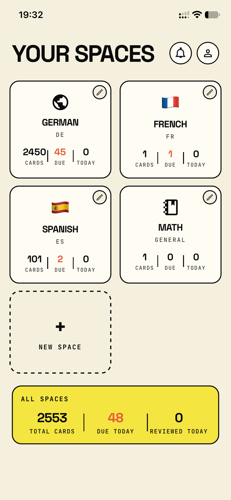
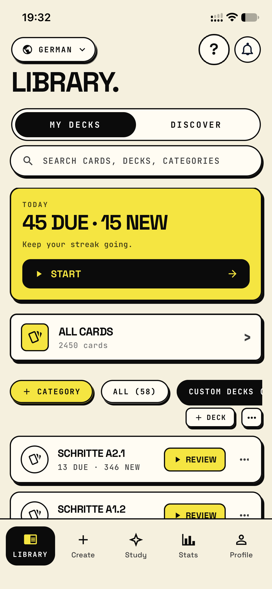
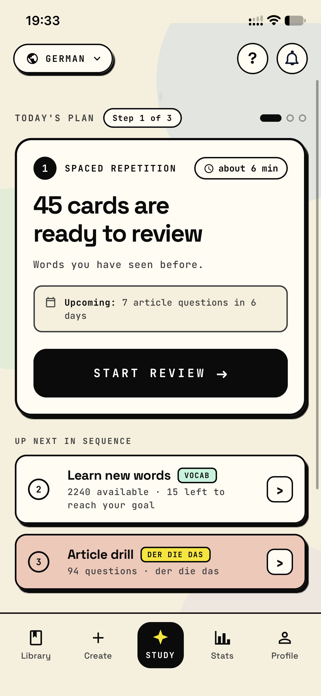
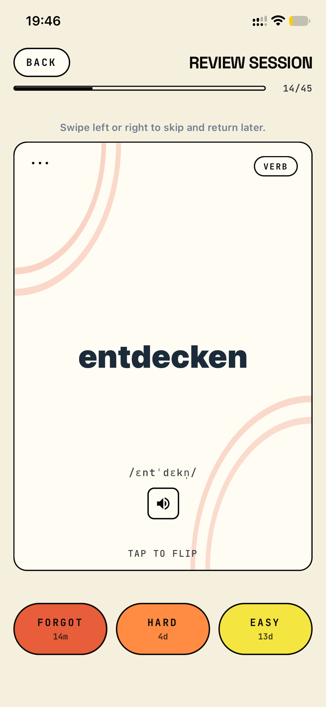
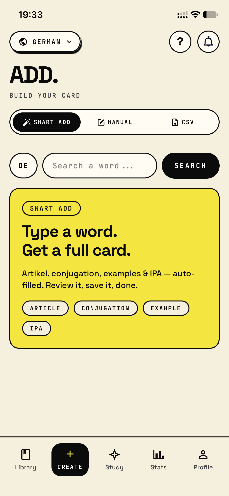
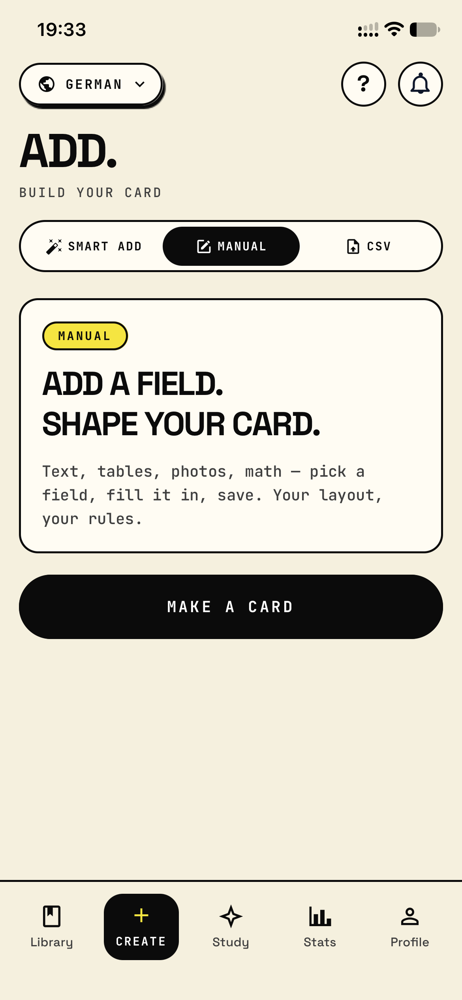
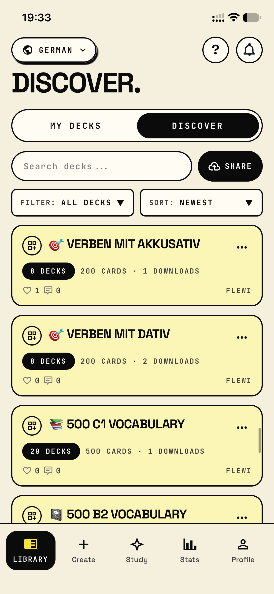
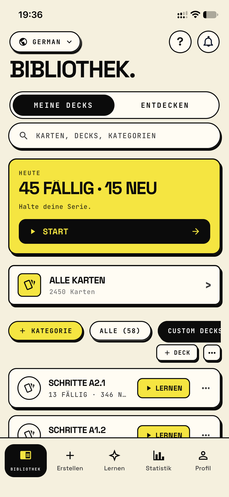

# Flewi

**Flewi is a spaced-repetition learning app for anything you need to remember.**
It started as German vocabulary and grew past it: a Space can be a language, a
school subject, or a professional exam. Cards come back on the day you are
about to forget them, and the app decides which day that is.

Live on iOS, Android and the web, built and shipped solo.

- **iOS** — [App Store](https://apps.apple.com/us/app/flewi/id6761818741)
- **Android** — direct download at [flewi.app/android](https://flewi.app/android)
- **Web** — [flewi.app](https://flewi.app)

Current release **2.0.4**.

*This repository is a showcase: the product itself is closed-source, and what
follows is an account of how it is built and what it does.*

---

## What it looks like

  
  
  
  

  
  
  
  

---

## The interesting problems

### Scheduling, and admitting what the schedule is doing

The review engine is a custom SRS. A wrong answer walks a card back down a
fixed ladder — ten minutes, an hour, six hours, a day — while a correct one
multiplies its interval by a per-card ease factor. The first "easy" out of
learning is a flat 2.5 days, and an "easy" straight after a lapse is capped at
one day, so a single lucky recall cannot undo the lapse.

The part worth pointing at is in the UI, not the algorithm: **each rating
button prints the interval it will apply before you press it.** Most apps hide
the schedule and ask for trust. Showing it costs nothing and turns an opaque
system into one the learner can reason about.

### Turning a backlog into a session

A due queue of 300 cards is a number that makes people close the app. Today's
plan is a numbered sequence — review, then new words, then the article drill —
with a time estimate on each step and the next one handed over as each
finishes. New cards are dealt round-robin across decks rather than draining the
oldest, so one large deck cannot starve the others. When the day's limit is
reached, the app says when the next cards unlock instead of going quiet.

### One word in, a whole card out

Smart Add takes a single word and fills a card from
[Kaikki](https://kaikki.org)/Wiktionary — article, conjugation, examples, IPA —
with pronunciation audio synthesised at save time. Every field is a toggle, so
the learner decides what ends up on the front and the back. The manual builder
takes the opposite approach: **the form is the card**, previewed exactly as it
will appear in review, so there is no gap between building it and seeing it.

Bulk import accepts CSV, with per-row audio either auto-generated or uploaded.

### German articles as their own drill

`der/die/das` is the part of German that resists ordinary flashcards, so it has
a separate engine with its own interval ladder and its own accuracy tracking —
including which article a learner wrongly reaches for when they miss, which
turns out to be the more useful signal.

### Finding the words that never stick

Cards that are repeatedly forgotten are surfaced as leeches with their forget
counts, alongside the ones that recovered. A learner who knows which eleven
words are the problem can do something about them.

---

## Engineering

**Mobile — React Native (Expo).** iOS and Android from one codebase. Sign in
with Apple and Google, App Store subscriptions, local and push notifications
for review reminders, fully localised in English and German.

**Web — React (Vite) + Tailwind.** An installable PWA with gesture-driven card
review, sharing one account and one review queue with mobile.

**API — FastAPI (async Python).** SQLAlchemy and Alembic over PostgreSQL,
Redis for caching and ephemeral state. Pytest suite with a CI gate that fails
on syntax the deployed interpreter cannot run — added after a release where
newer annotation syntax passed locally and broke in production.

**Infrastructure — Docker Compose**, Caddy as reverse proxy with automatic
TLS, zero-downtime deploys.

---

## What is in 2.0.4

- Today's plan became a numbered sequence with time estimates and a handoff
  between steps
- Every rating button shows its interval before you press it
- The Library was rebuilt around user-defined categories, with one Today card
  carrying everything due and new
- Collections became **Discover**: browse decks other people have shared, or
  publish your own
- The app is fully German, dashboard included
- New cards are dealt across decks instead of draining the oldest
- Stats rebuilt to count seven days rather than seven rows

---

## Pricing

A permanent free plan — 10 new cards and 20 reviews a day, across every Space.
Paid plans lift the limits: **Simple €2.99/month**, **Pro €6.99/month**.
Shared decks are free to download.
